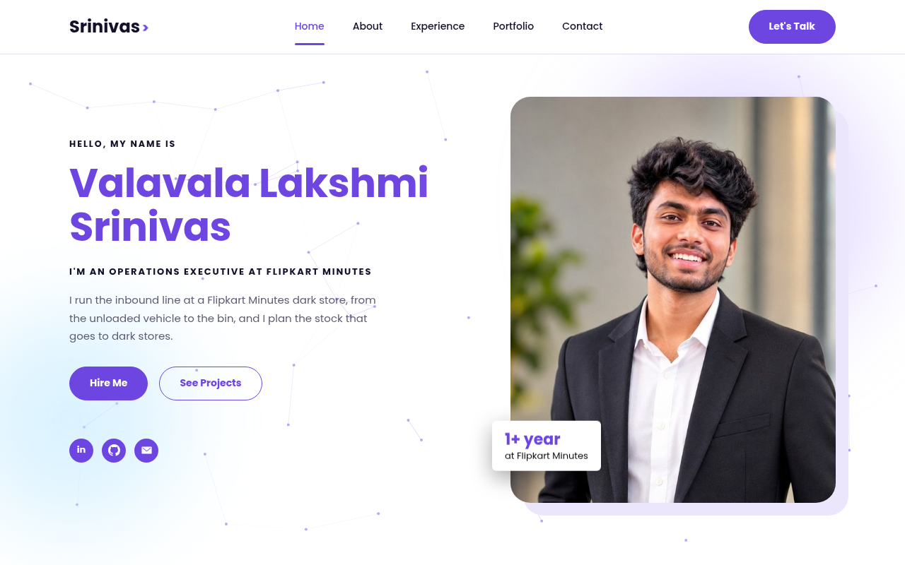
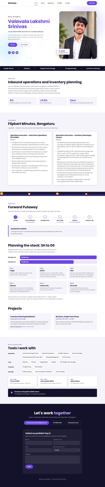

# 🚀 Srinivas-portfolio

**Valavala Lakshmi Srinivas Portfolio**

This repository contains the source code for my personal portfolio website. The README gives an overview of the project and explains how to view it, run it and customize it for your own use.

## My Portfolio is live at: https://srinivas4441.github.io/

## 📚 Table of Contents

- [Features](#-features)
- [Screenshots](#-screenshots)
- [Getting Started](#-getting-started)
  - [Prerequisites](#prerequisites)
  - [Installation](#installation)
  - [Usage](#usage)
- [Customization](#-customization)
- [Deployment](#-deployment)
- [Contributing](#-contributing)
- [License](#-license)
- [Connect With Me](#-connect-with-me)

## ✨ Features

- Responsive design for desktop and mobile screens
- Sections for About, Experience, Portfolio, Skills, Education and Contact
- Showcases real work: Dark Store Operations (First Mile) and Inventory Planning & Control
- Clickable **Forward Putaway** flow, from unloading the vehicle to ready-for-sale
- Step-by-step view of how stock is planned from source hubs (SH) to dark stores (DS)
- Smooth animations: particle background, typing line, counters, moving conveyor belt
- Resume download button and a visitor form
- Single HTML file with no frameworks and no build step

## 📸 Screenshots



<details>
<summary>See the full page</summary>



</details>

## 🏁 Getting Started

### Prerequisites

- Any modern web browser (Chrome, Edge, Firefox or Safari)
- Git (optional, only if you want to clone the repository)

### Installation

1. Clone the repository:
   ```bash
   git clone https://github.com/Srinivas4441/Srinivas4441.github.io.git
   ```
2. Go into the folder:
   ```bash
   cd Srinivas4441.github.io
   ```

You can also click **Code → Download ZIP** and extract it.

### Usage

Open `index.html` in your browser. The portfolio runs locally with no setup.

## 🎨 Customization

- **Text and sections:** edit the content inside `index.html`.
- **Colors:** change the color values at the top of the `<style>` block (for example `--purple`).
- **Photo:** replace the image in the hero section with your own photo.
- **Resume:** replace `Valavala_Lakshmi_Srinivas_Resume.pdf` with your own file, keeping the same name.

## 🌐 Deployment

**GitHub Pages**
1. Create a public repository named `<your-username>.github.io`.
2. Upload `index.html` and the resume PDF.
3. Go to **Settings → Pages**, choose branch `main` and folder `/ (root)`, then **Save**.
4. Your site goes live at `https://<your-username>.github.io/` within a couple of minutes.

**Netlify (needed for the visitor form)**
1. Open `app.netlify.com/drop`.
2. Drag the project folder onto the page to get a live link.

## 🤝 Contributing

Suggestions and feedback are welcome. Please open an issue in this repository or message me on LinkedIn.

## 📄 License

© Valavala Lakshmi Srinivas. All rights reserved. Please ask before reusing my photo, text or resume.

## 📬 Connect With Me

- 📧 Email: srinivasvalavala4441@gmail.com
- 💼 LinkedIn: [Valavala Lakshmi Srinivas](https://www.linkedin.com/in/valavala-lakshmi-srinivas-1246a225a/)
- 💻 GitHub: [Srinivas4441](https://github.com/Srinivas4441)
- 🌐 Portfolio: [srinivas4441.github.io](https://srinivas4441.github.io/)
